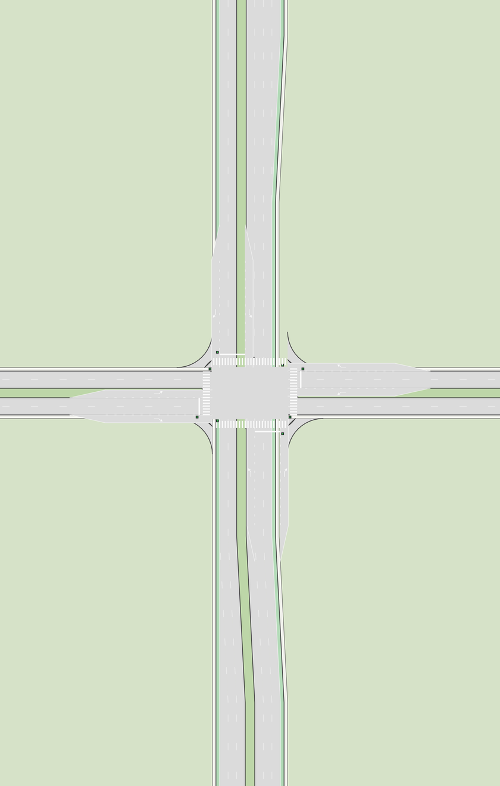
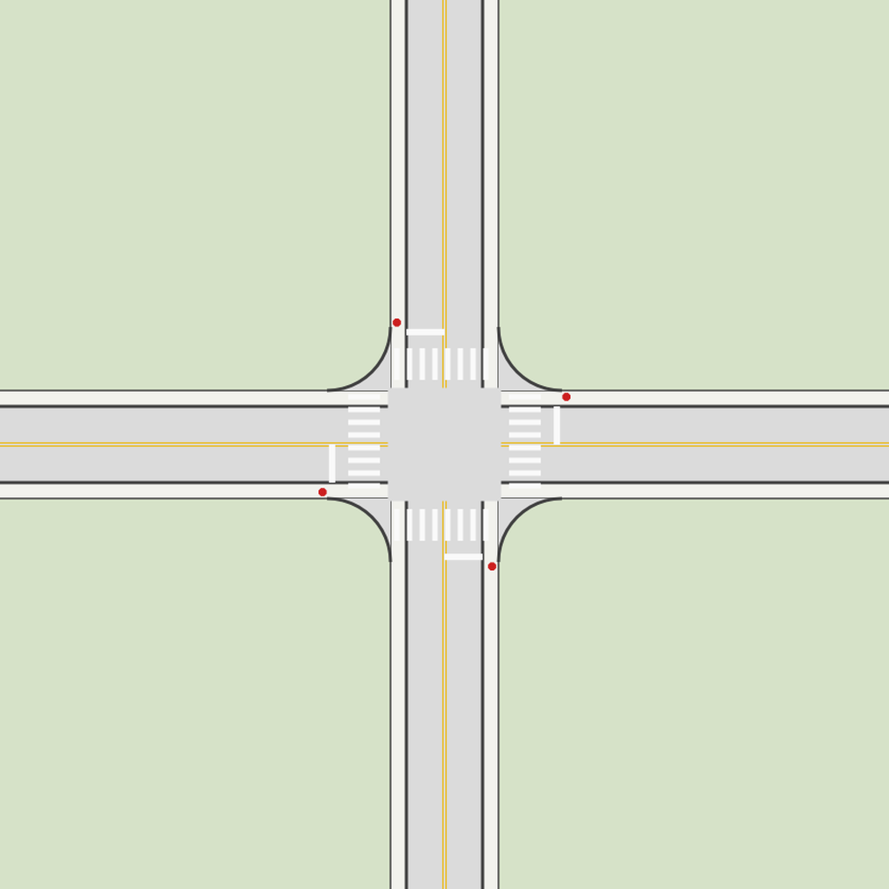

# Road Builder for VectorCraft

Draw a road as **one line**; Road Builder builds the lanes, kerbs, markings, signs, signals and intersections from it. Describe what you want in plain
words or with a few choices, press **Draw**, and edit the line to reshape the road. Your line is never changed, only what is built from it.

<p align="center"><br>
<em>A complex multi-lane intersection, built from two lines: a divided 3+3-lane road with bike lanes and sidewalks crossing a divided 2+2-lane road at traffic signals, with left and right turn pockets (45 m, tapered), slip lanes with islands, crosswalks, a far-side signal head for each approach, a northbound lane added 70 m north of the intersection and a southbound lane dropped south of it.</em></p>

<p align="center"><br>
<em>A simple four-way stop: two two-lane streets with sidewalks, a stop sign and stop bar on every approach, crosswalks, and 6 m kerb returns. Both images are drawn by the plug-in itself, with the editable lines hidden.</em></p>

> Every drawing is an **illustrative reconstruction, not a survey**. Dimensions follow the US MUTCD where it sets one and are typical values where it does not (see [Standards](#standards)).

## What is in it

| Part | What it does |
|---|---|
| **Build Road** (plug-in, filter) | Regenerates everything from the lines you drew: road strips and paint, junctions, intersections, lane changes. Commands: Describe Road, Describe Junction, Make Intersection, Make Intersection of Three or More Roads, Add or Drop a Lane, Add Junction. |
| **Road Builder road (.pmap)** (importer and exporter) | Opens and writes a compact, diff-friendly JSON road file (see [the .pmap format](#the-pmap-format)). |
| **Companion panel** (a small local web page) | Follows your selection, takes a description in words, shows what a change would do before it happens, and draws it. |
| **Element library** (`library/elements.json`) | 16 road elements with typical widths: lane, turn pocket, bike lane, apron, shoulder, margin, median, sidewalk, parking lane, railway ... |
| **Standards database** (`library/standards.json`) | 56 dimensions from the MUTCD, PROWAG and state manuals, each with section, quote and a verified status. |

Written in Rust (plug-ins compiled to WebAssembly, sharing one core) and zero-dependency Node (the panel). MIT licensed.

## Quick start

1. Download the latest release, unzip it, and run `sh install.sh` (puts the plug-ins into VectorCraft; needs `vectorcraft-cli`).
2. Run `sh start.sh`: it opens VectorCraft with its control port, starts the panel and opens it in your browser.
3. Draw a line, select it, describe the road, press **Draw**. Select two lines to make an intersection.

Full walk-through: **[docs/GETTING-STARTED.md](docs/GETTING-STARTED.md)**. From source: `sh scripts/build.sh`, `sh scripts/install.sh`, `sh scripts/start-panel.sh`.
Needs VectorCraft 0.24.1 or newer and Node 20 or newer; the plain-words agent needs Claude Code signed in (or another agent in `panel/providers.json`), the cards work without one.

## What you can build

**Roads from a description.** Draw any line (Bezier curves stay smooth, angle points stay sharp corners: outside mitred, inside trimmed) and describe the road left to right:

```
facing N: bike-lane | apron | lane S x2 | margin 3 | lane N x2 | apron | bike-lane
```

Strips are filled and the paint between elements follows the MUTCD: dashed white between lanes the same way, double yellow between opposite ways, kerb lines at a margin. Break a line and both pieces keep the description; describe one piece alone and it gets its own.

**Lane changes.** Select a line, choose **Add or drop a lane on this line**: 1 to 3 lanes in one direction, on the driver's left (toward the centre) or right (toward the edge), over a taper that follows the MUTCD formula for the speed (or your length). Several in a row take a road from 1 to 4 lanes and back.

**Intersections** (select two roads, or three or more):

| Kind | What is drawn |
|---|---|
| Lighted intersection | Paved box at any angle, true-arc kerb returns, crosswalks, stop bars, a primary signal head on the far side and a supplemental one at the bar |
| Two-way and four-way stop | Stop signs (30 or 36 in, to size) and stop bars where the rules put them |
| Roads that only touch, driveway, offset and skewed tees | A side road drawn up to the kerb is found and carried onto the pavement; a driveway has a small return and no marks |
| Stubs | A short road past the crossing is kept as a dead end (four-way) or trimmed to a three-way |
| Turn pockets, slip lanes | Left pockets cut into a median, right pockets widen the road, length and taper; slip lanes with a kerbed island |
| Median opening, mid-block crossing, railroad | An opening with kerbed noses; crosswalk bars over the lanes with yield lines and beacons; rails, ties, crossbucks and gates |
| On-ramp and off-ramp (merge, converge, diverge) | Either side of the road, with a speed-change lane and a gore with chevrons |
| Roundabout, overpass or underpass, cloverleaf | A ring with splitter islands and yield lines; a bridge deck; the bridge plus four loop ramps |
| Three or more roads at a point | Arms sorted by bearing, a core bounded by neighbouring kerb lines, a kerb return at every corner |

Every treatment, field and rule is in **[docs/SCENARIOS.md](docs/SCENARIOS.md)**.

**Junctions** (older model): a short line between two road pieces can carry the road across the gap or become a T or four-way junction with up to two legs.

## How it works

- **Lines in, drawing out.** A line named `road.<id>` is a road; its description (cross-section, intersections, lane changes, hubs) is stored *in the VectorCraft document* as plug-in data. **Build Road** regenerates every `gen.*` shape from the lines and the stored descriptions, so rebuilding is repeatable and your lines are never edited. Intersections and lane changes cut or extend the *drawn* road only.
- **One layer per road.** After each Draw the panel sorts the drawing into layers: `road r1` holds `road r1 spine` (the bold red line you edit, on top) and `road r1 drawing`. Hide or lock the spine and the road stays visible. A filter only sees visible, unlocked objects, so the panel shows and unlocks these layers for the rebuild and puts your hiding and locking back.
- **The agent proposes, a checker decides.** An agent turns words into shorthand or JSON; a native helper (`road-builder-cli`) validates every answer (it must parse, use known elements and make sense for the road) and sends an invalid one back once. Nothing is applied until you press Draw, and every proposal lists **what it changes** in plain words. If an agent cannot give a valid answer, the panel tries its fallback agent. Notes from the build (things guessed or skipped) are shown in the panel.
- **Agents are pluggable** (`panel/providers.json`): Claude (default, uses your Claude login), a command that reads a JSON request on stdin, any OpenAI-compatible endpoint, or Apple Intelligence on this Mac (optional; hidden if not installed). The panel listens on 127.0.0.1 only and refuses requests that did not come from its own page.
- **Plug-in limits.** VectorCraft runs plug-ins in an interpreter under an instruction budget, so Build Road writes its output as text and thins redundant points; a 5 km road builds well within it.

## Standards

`library/standards.json` records the US standards behind the dimensions: the **MUTCD 11th Edition with Revision 1** (stop lines 12 to 24 in and set back 4 ft, crosswalk bars, yield-line triangles, gore chevrons, signal head position and height, STOP sign sizes, grade-crossing stop lines and gates), the **US Access Board PROWAG** (clear widths, refuge islands, curb ramp slopes), and state design manuals (FDOT, SCDOT, WisDOT) where the federal documents leave a number to the designer (turn-lane tapers and queues, median widths, roundabout sizes). Each entry has the section, a verbatim quote and a status: *verified* (read in the federal text), *verified-secondary* (a state manual) or *unverified*. A test ties the code's own constants to it and the document is generated: **[docs/STANDARDS.md](docs/STANDARDS.md)**. The NTSB investigates crashes and recommends changes; it does not publish design dimensions. Lane, bike-lane and kerb-radius widths are typical, not standards (the MUTCD sets none; the AASHTO Green Book does, and is copyrighted).

## Documents

| | |
|---|---|
| [docs/GETTING-STARTED.md](docs/GETTING-STARTED.md) | Install and first steps, in plain language |
| [docs/SCENARIOS.md](docs/SCENARIOS.md) | Every intersection and lane treatment, its fields and rules |
| [docs/STANDARDS.md](docs/STANDARDS.md) | The standards database, generated |
| [docs/DESIGN.md](docs/DESIGN.md) | Design notes and what each phase found |
| [CHANGELOG.md](CHANGELOG.md) | What changed in each version |
| [CLAUDE.md](CLAUDE.md) | Layout, traps and the recipe for adding a scenario (for people and agents working on the code) |

## What you edit with the older centerline model (naming contract)

| Path name | Meaning |
|---|---|
| `centerline` | The road's centre path. Route metre `s` counts along it from its first point. Offsets are positive to the right of the direction of travel. |
| `profile.zero` | Baseline of the profile band (below the road). Its first point is route metre 0, offset 0. |
| `profile.<key>` | A lane or edge line drawn in (s, offset) space: x = route metre, height above the baseline = offset. Keys: `sbOuter sbLane sbInner nbInner nbLane nbOuter sbTurn nbTurn sbBuf nbBuf sbEdge nbEdge`. Drag a point to change a lane width at that station. |
| `flag.<name>.<n>` | A horizontal bar whose x-extent is a stretch where the flag is on: `gap` (median opening), `mouth` (driveway mouth), `closed`, `rtOnly`, `median`, `buffer`, `bridge`. |
| `<L><n>.<kind>.<side>[.<street>]` | A junction marker on the road, e.g. `C1.signal.right.Main-St`. Kinds: `tee cross street drive signal school`. Side (as seen driving along the centerline): `right left both`. |
| `arrow.<kind>.<N\|S>.<s>` | A pavement arrow; first two points are tail and tip. `<s>` is its approximate route metre. |
| `gen.*` | Generated by Build Road. Never edit these; they are replaced on every build. |

Everything is in metres (1 document point = 1 metre; y points down, so north is up).

## The pmap format

```
{"format": "vectorcraft-road-builder/pmap", "version": 1, "length": 5266.3,
 "centerline": [[x, y], ...],              metres from the first point, x east, y north
 "profile":  {"sbEdge": [[s, offset], ...], ...},
 "flags":    {"gap": [[s0, s1], ...], ...},
 "junctions": [{"id": "C1", "s": 112, "kind": "signal", "side": "right", "label": "Main-St"}],
 "arrows":   [{"s": 138, "off": -11.8, "kind": "thru", "south": true}]}
```

Numbers are rounded to a millimetre and written one item per line, so a diff shows exactly what changed. `import` then `export`
returns the same bytes.

## Develop

```
sh scripts/build.sh                  # needs rustup + the wasm32-unknown-unknown target (see the script header)
cargo test --release                 # 100 native tests: geometry, every scenario, the standards database, the round trip
node --test panel/test/              # 53 panel tests against a fake VectorCraft (needs the helper: cargo build --release -p road-builder-cli)
node scripts/standards.mjs check     # validates the standards database; "md" regenerates docs/STANDARDS.md
sh scripts/package.sh 0.6.0          # builds the release package into dist/
node scripts/vc.mjs <method> '<json>'   # drive a running VectorCraft (open -a VectorCraft --args --control 7979)
```

CI (`.github/workflows/ci.yml`) runs the same on every push; pushing a tag like `v0.6.0` builds and publishes a release (`release.yml`).

Layout: `core/` (geometry, cross-sections, roads, junctions, crossings, hubs, lane transitions, standards constants, ABI glue; unit-tested natively),
`filter/ exporter/ importer/` (thin plug-in crates), `cli/` (the validating helper), `panel/` (server, page, layers, agents), `library/`, `docs/`,
`scripts/`, `examples/`. Adding a scenario follows the recipe in `CLAUDE.md`: spec, geometry, tests with hand-worked numbers, panel card, agent prompt, docs.

### Limits worth knowing

- Plug-in command ids are lower-case with underscores; a parameter cannot be called `id`.
- Build Road deletes the `gen.*` paths it is given and keeps everything else, but it only sees what is selected, visible and unlocked: Select All first (the panel does this for you).
- A lane change is drawn by sampling the line every 2 m: keep tapers on gentle curves. Cloverleaf draws the four loop ramps, not the diagonal connectors.
- The Build styling (colours, dash lengths) is a plain placeholder.

License: MIT.
